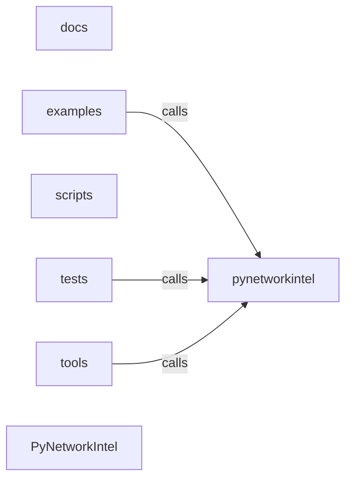

_Generated by CodeAtlas._

## Details

Architecture map of PyNetworkIntel.

### docs

Owns 0 symbols across 6 file(s).

**Related Classes/Methods:** _None_

### examples

Owns 7 symbols across 2 file(s).

**Related Classes/Methods:** _None_

**Source Files:**

- `examples/dashboard_demo.py`
  - `examples.dashboard_demo.main`
  - `examples.dashboard_demo.simulate_scan`
  - `examples.dashboard_demo.standalone_dashboard_example`
- `examples/phase1_2_demo.py`
  - `examples.phase1_2_demo.main`
  - `examples.phase1_2_demo.test_llm_summarization`
  - `examples.phase1_2_demo.test_phase1_discovery`
  - `examples.phase1_2_demo.test_phase2_analysis`

### pynetworkintel

Owns 223 symbols across 16 file(s).

**Related Classes/Methods:** _None_

**Source Files:**

- `pynetworkintel/_mcp_connector.py`
  - `pynetworkintel._mcp_connector.NetworkIntelligence`
  - `pynetworkintel._mcp_connector.NetworkIntelligence.__init__`
  - `pynetworkintel._mcp_connector.NetworkIntelligence._devices_for_target`
  - `pynetworkintel._mcp_connector.NetworkIntelligence._filter_ports`
  - `pynetworkintel._mcp_connector.NetworkIntelligence._findings_for_device`
  - `pynetworkintel._mcp_connector.NetworkIntelligence._latest_scan`
  - `pynetworkintel._mcp_connector.NetworkIntelligence._match_indicator_findings`
  - `pynetworkintel._mcp_connector.NetworkIntelligence.analyze_dns_records`
  - `pynetworkintel._mcp_connector.NetworkIntelligence.analyze_network_flow`
  - `pynetworkintel._mcp_connector.NetworkIntelligence.behavioral_profiling`
  - `pynetworkintel._mcp_connector.NetworkIntelligence.check_port_exposure`
  - `pynetworkintel._mcp_connector.NetworkIntelligence.detect_anomalies`
  - `pynetworkintel._mcp_connector.NetworkIntelligence.export_security_report`
  - `pynetworkintel._mcp_connector.NetworkIntelligence.get_asset_inventory`
  - `pynetworkintel._mcp_connector.NetworkIntelligence.get_geolocation_analysis`
  - `pynetworkintel._mcp_connector.NetworkIntelligence.get_threat_intelligence`
  - `pynetworkintel._mcp_connector.NetworkIntelligence.network_segmentation_analysis`
  - `pynetworkintel._mcp_connector.NetworkIntelligence.protocol_analysis`
  - `pynetworkintel._mcp_connector.NetworkIntelligence.remediation_recommendations`
  - `pynetworkintel._mcp_connector.NetworkIntelligence.start_mcp_connector`
  - `pynetworkintel._mcp_connector.NetworkIntelligence.stop_mcp_connector`
  - `pynetworkintel._mcp_connector.NetworkIntelligence.threat_correlation`
- `pynetworkintel/_mcp_tools.py`
  - `pynetworkintel._mcp_tools.PyNetworkIntelMCPHandler`
  - `pynetworkintel._mcp_tools.PyNetworkIntelMCPHandler.__init__`
  - `pynetworkintel._mcp_tools.PyNetworkIntelMCPHandler.analyze_dns_records`
  - `pynetworkintel._mcp_tools.PyNetworkIntelMCPHandler.analyze_network_flow`
  - `pynetworkintel._mcp_tools.PyNetworkIntelMCPHandler.behavioral_profiling`
  - `pynetworkintel._mcp_tools.PyNetworkIntelMCPHandler.check_port_exposure`
  - `pynetworkintel._mcp_tools.PyNetworkIntelMCPHandler.detect_anomalies`
  - `pynetworkintel._mcp_tools.PyNetworkIntelMCPHandler.export_security_report`
  - `pynetworkintel._mcp_tools.PyNetworkIntelMCPHandler.get_asset_inventory`
  - `pynetworkintel._mcp_tools.PyNetworkIntelMCPHandler.get_geolocation_analysis`
  - `pynetworkintel._mcp_tools.PyNetworkIntelMCPHandler.get_threat_intelligence`
  - `pynetworkintel._mcp_tools.PyNetworkIntelMCPHandler.network_segmentation_analysis`
  - `pynetworkintel._mcp_tools.PyNetworkIntelMCPHandler.protocol_analysis`
  - `pynetworkintel._mcp_tools.PyNetworkIntelMCPHandler.remediation_recommendations`
  - `pynetworkintel._mcp_tools.PyNetworkIntelMCPHandler.threat_correlation`
  - `pynetworkintel._mcp_tools.PyNetworkIntelMCPTools`
  - `pynetworkintel._mcp_tools.PyNetworkIntelMCPTools.get_tools`
  - `pynetworkintel._mcp_tools._with_error_result`
  - `pynetworkintel._mcp_tools._with_error_result.wrapped`
- `pynetworkintel/alerts.py`
  - `pynetworkintel.alerts.AlertChannel`
  - `pynetworkintel.alerts.AlertChannel.send`
  - `pynetworkintel.alerts.AlertManager`
  - `pynetworkintel.alerts.AlertManager.__init__`
  - `pynetworkintel.alerts.AlertManager._save_alert`
  - `pynetworkintel.alerts.AlertManager._send_alert`
  - `pynetworkintel.alerts.AlertManager.acknowledge_alert`
  - `pynetworkintel.alerts.AlertManager.add_channel`
  - `pynetworkintel.alerts.AlertManager.add_rule`
  - `pynetworkintel.alerts.AlertManager.create_alert`
  - `pynetworkintel.alerts.AlertManager.get_pending_alerts`
  - `pynetworkintel.alerts.EmailAlertChannel`
  - `pynetworkintel.alerts.EmailAlertChannel.__init__`
  - `pynetworkintel.alerts.EmailAlertChannel.send`
  - `pynetworkintel.alerts.SlackAlertChannel`
  - `pynetworkintel.alerts.SlackAlertChannel.__init__`
  - `pynetworkintel.alerts.SlackAlertChannel.send`
  - `pynetworkintel.alerts.WebhookAlertChannel`
  - `pynetworkintel.alerts.WebhookAlertChannel.__init__`
  - `pynetworkintel.alerts.WebhookAlertChannel.send`
- `pynetworkintel/changes.py`
  - `pynetworkintel.changes.ChangeDetector`
  - `pynetworkintel.changes.ChangeDetector.__init__`
  - `pynetworkintel.changes.ChangeDetector._mark_vulnerability_resolved`
  - `pynetworkintel.changes.ChangeDetector._record_device_change`
  - `pynetworkintel.changes.ChangeDetector._record_vulnerability_change`
  - `pynetworkintel.changes.ChangeDetector.detect_device_changes`
  - `pynetworkintel.changes.ChangeDetector.detect_vulnerability_changes`
  - `pynetworkintel.changes.ChangeDetector.get_previous_scan_findings`
  - `pynetworkintel.changes.ChangeReporter`
  - `pynetworkintel.changes.ChangeReporter.summarize_changes`
- `pynetworkintel/cli.py`
  - `pynetworkintel.cli.confirm_authorization`
  - `pynetworkintel.cli.format_analysis_output`
  - `pynetworkintel.cli.format_scan_output`
  - `pynetworkintel.cli.handle_analyze`
  - `pynetworkintel.cli.handle_dashboard`
  - `pynetworkintel.cli.handle_init_config`
  - `pynetworkintel.cli.handle_scan`
  - `pynetworkintel.cli.main`
  - `pynetworkintel.cli.render_topology_output`
- `pynetworkintel/config.py`
  - `pynetworkintel.config.AnalysisConfig`
  - `pynetworkintel.config.AnalysisConfig.to_dict`
  - `pynetworkintel.config.AppConfig`
  - `pynetworkintel.config.AppConfig.to_dict`
  - `pynetworkintel.config.ConfigManager`
  - `pynetworkintel.config.ConfigManager.__init__`
  - `pynetworkintel.config.ConfigManager._load_config`
  - `pynetworkintel.config.ConfigManager._parse_config`
  - `pynetworkintel.config.ConfigManager.create_default_config`
  - `pynetworkintel.config.ConfigManager.get_default_config`
  - `pynetworkintel.config.ConfigManager.save_config`
  - `pynetworkintel.config.ConfigManager.update_from_env`
  - `pynetworkintel.config.OutputConfig`
  - `pynetworkintel.config.OutputConfig.to_dict`
  - `pynetworkintel.config.SSHConfig`
  - `pynetworkintel.config.SSHConfig.to_dict`
  - `pynetworkintel.config.ScanConfig`
  - `pynetworkintel.config.ScanConfig.to_dict`
- `pynetworkintel/core.py`
  - `pynetworkintel.core.Analyzer`
  - `pynetworkintel.core.Analyzer.__init__`
  - `pynetworkintel.core.Analyzer.analyze`
  - `pynetworkintel.core.Analyzer.get_summary`
  - `pynetworkintel.core.Analyzer.summarize`
  - `pynetworkintel.core.Pipeline`
  - `pynetworkintel.core.Pipeline.__init__`
  - `pynetworkintel.core.Pipeline.run`
  - `pynetworkintel.core.Scanner`
  - `pynetworkintel.core.Scanner.__init__`
  - `pynetworkintel.core.Scanner.scan`
- `pynetworkintel/dashboard.py`
  - `pynetworkintel.dashboard.Dashboard`
  - `pynetworkintel.dashboard.Dashboard.__init__`
  - `pynetworkintel.dashboard.Dashboard._build_details`
  - `pynetworkintel.dashboard.Dashboard._build_footer`
  - `pynetworkintel.dashboard.Dashboard._build_header`
  - `pynetworkintel.dashboard.Dashboard._build_layout`
  - `pynetworkintel.dashboard.Dashboard._build_summary`
  - `pynetworkintel.dashboard.Dashboard._format_duration`
  - `pynetworkintel.dashboard.Dashboard.run`
  - `pynetworkintel.dashboard.DashboardClient`
  - `pynetworkintel.dashboard.DashboardClient.__init__`
  - `pynetworkintel.dashboard.DashboardClient._get_stats_unix`
  - `pynetworkintel.dashboard.DashboardClient._get_stats_windows`
  - `pynetworkintel.dashboard.DashboardClient.get_stats`
  - `pynetworkintel.dashboard.DashboardServer`
  - `pynetworkintel.dashboard.DashboardServer.__init__`
  - `pynetworkintel.dashboard.DashboardServer._get_socket_path`
  - `pynetworkintel.dashboard.DashboardServer._run_server`
  - `pynetworkintel.dashboard.DashboardServer._run_unix_server`
  - `pynetworkintel.dashboard.DashboardServer._run_windows_server`
  - `pynetworkintel.dashboard.DashboardServer.start`
  - `pynetworkintel.dashboard.DashboardServer.stop`
  - `pynetworkintel.dashboard.StatsCollector`
  - `pynetworkintel.dashboard.StatsCollector.__init__`
  - `pynetworkintel.dashboard.StatsCollector.to_dict`
  - `pynetworkintel.dashboard.TerminalLauncher`
  - `pynetworkintel.dashboard.TerminalLauncher._launch_linux`
  - `pynetworkintel.dashboard.TerminalLauncher._launch_macos`
  - `pynetworkintel.dashboard.TerminalLauncher._launch_windows`
  - `pynetworkintel.dashboard.TerminalLauncher.get_platform`
  - `pynetworkintel.dashboard.TerminalLauncher.launch_dashboard`
  - `pynetworkintel.dashboard.launch_stats_dashboard`
- `pynetworkintel/db.py`
  - `pynetworkintel.db.Alert`
  - `pynetworkintel.db.Database`
  - `pynetworkintel.db.Database.__init__`
  - `pynetworkintel.db.Database.close`
  - `pynetworkintel.db.Database.create_all`
  - `pynetworkintel.db.Database.get_session`
  - `pynetworkintel.db.Device`
  - `pynetworkintel.db.DeviceChange`
  - `pynetworkintel.db.DeviceConfig`
  - `pynetworkintel.db.Finding`
  - `pynetworkintel.db.ScanSession`
  - `pynetworkintel.db.Service`
  - `pynetworkintel.db.VulnerabilityChange`
  - `pynetworkintel.db.get_db`
  - `pynetworkintel.db.init_db`
- `pynetworkintel/models.py`
  - `pynetworkintel.models.ConfigFile`
  - `pynetworkintel.models.ConfigFile.to_dict`
  - `pynetworkintel.models.Device`
  - `pynetworkintel.models.Device.add_config`
  - `pynetworkintel.models.Device.add_service`
  - `pynetworkintel.models.Device.to_dict`
  - `pynetworkintel.models.FindingType`
  - `pynetworkintel.models.ScanResult`
  - `pynetworkintel.models.ScanResult.summary`
  - `pynetworkintel.models.ScanResult.to_dict`
  - `pynetworkintel.models.ScanResult.topology`
  - `pynetworkintel.models.SecurityFinding`
  - `pynetworkintel.models.SecurityFinding.to_dict`
  - `pynetworkintel.models.Service`
  - `pynetworkintel.models.Service.to_dict`
  - `pynetworkintel.models.Severity`
- `pynetworkintel/progress.py`
  - `pynetworkintel.progress.OutputFormatter`
  - `pynetworkintel.progress.OutputFormatter.__init__`
  - `pynetworkintel.progress.OutputFormatter.format_findings_table`
  - `pynetworkintel.progress.OutputFormatter.format_scan_time`
  - `pynetworkintel.progress.OutputFormatter.format_summary_table`
  - `pynetworkintel.progress.ProgressIndicator`
  - `pynetworkintel.progress.ProgressIndicator.__init__`
  - `pynetworkintel.progress.ProgressIndicator.error`
  - `pynetworkintel.progress.ProgressIndicator.progress`
  - `pynetworkintel.progress.ProgressIndicator.section`
  - `pynetworkintel.progress.ProgressIndicator.status`
  - `pynetworkintel.progress.ProgressIndicator.success`
  - `pynetworkintel.progress.ProgressIndicator.warning`
- `pynetworkintel/reporting.py`
  - `pynetworkintel.reporting.ReportGenerator`
  - `pynetworkintel.reporting.ReportGenerator.__init__`
  - `pynetworkintel.reporting.ReportGenerator.export_to_file`
  - `pynetworkintel.reporting.ReportGenerator.generate_change_report`
  - `pynetworkintel.reporting.ReportGenerator.generate_device_inventory_report`
  - `pynetworkintel.reporting.ReportGenerator.generate_markdown_report`
  - `pynetworkintel.reporting.ReportGenerator.generate_summary_report`
  - `pynetworkintel.reporting.ReportGenerator.generate_vulnerability_report`
- `pynetworkintel/scheduler.py`
  - `pynetworkintel.scheduler.MonitoringScheduler`
  - `pynetworkintel.scheduler.MonitoringScheduler.__init__`
  - `pynetworkintel.scheduler.MonitoringScheduler._detect_changes`
  - `pynetworkintel.scheduler.MonitoringScheduler._generate_alerts`
  - `pynetworkintel.scheduler.MonitoringScheduler._run_scan`
  - `pynetworkintel.scheduler.MonitoringScheduler._save_scan_results`
  - `pynetworkintel.scheduler.MonitoringScheduler._signal_handler`
  - `pynetworkintel.scheduler.MonitoringScheduler.add_scan_job`
  - `pynetworkintel.scheduler.MonitoringScheduler.list_jobs`
  - `pynetworkintel.scheduler.MonitoringScheduler.run_foreground`
  - `pynetworkintel.scheduler.MonitoringScheduler.start`
  - `pynetworkintel.scheduler.MonitoringScheduler.stop`
- `pynetworkintel/topology.py`
  - `pynetworkintel.topology.NetworkTopology`
  - `pynetworkintel.topology.NetworkTopology.adjacency`
  - `pynetworkintel.topology.NetworkTopology.devices_by_subnet`
  - `pynetworkintel.topology.NetworkTopology.from_dict`
  - `pynetworkintel.topology.NetworkTopology.to_dict`
  - `pynetworkintel.topology.TopologyEdge`
  - `pynetworkintel.topology.TopologyEdge.to_dict`
  - `pynetworkintel.topology.TopologyMapper`
  - `pynetworkintel.topology.TopologyMapper.__init__`
  - `pynetworkintel.topology.TopologyMapper._infer_gateway`
  - `pynetworkintel.topology.TopologyMapper._infer_subnet`
  - `pynetworkintel.topology.TopologyMapper.build`
  - `pynetworkintel.topology.TopologyNode`
  - `pynetworkintel.topology.TopologyNode.to_dict`
- `pynetworkintel/topology_export.py`
  - `pynetworkintel.topology_export.export_topology`
  - `pynetworkintel.topology_export.node_link_json_str`
  - `pynetworkintel.topology_export.to_graphml`
  - `pynetworkintel.topology_export.to_node_link_json`

### scripts

Owns 0 symbols across 2 file(s).

**Related Classes/Methods:** _None_

### tests

Owns 231 symbols across 18 file(s).

**Related Classes/Methods:** _None_

**Source Files:**

- `tests/test_analysis.py`
  - `tests.test_analysis.TestCVEChecker`
  - `tests.test_analysis.TestCVEChecker.test_cache_cves`
  - `tests.test_analysis.TestCVEChecker.test_create_cve_checker`
  - `tests.test_analysis.TestCVEChecker.test_cvss_to_severity`
  - `tests.test_analysis.TestRuleChecker`
  - `tests.test_analysis.TestRuleChecker.test_create_rule_checker`
  - `tests.test_analysis.TestRuleChecker.test_detect_ssh_password_auth`
  - `tests.test_analysis.TestRuleChecker.test_detect_telnet`
  - `tests.test_analysis.TestRuleChecker.test_extract_evidence`
  - `tests.test_analysis.TestRuleChecker.test_no_violations`
- `tests/test_architect_recommendation_engine.py`
  - `tests.test_architect_recommendation_engine.TestGenerateRoiAnalysis`
  - `tests.test_architect_recommendation_engine.TestGenerateRoiAnalysis.test_negative_cost_impact_computes_payback_from_savings`
  - `tests.test_architect_recommendation_engine.TestGenerateRoiAnalysis.test_positive_cost_impact_with_no_modeled_savings_does_not_raise`
  - `tests.test_architect_recommendation_engine.TestGenerateRoiAnalysis.test_zero_cost_impact_does_not_raise`
- `tests/test_cloud.py`
  - `tests.test_cloud.TestAssetMapping`
  - `tests.test_cloud.TestAssetMapping.test_defaults_are_independent_lists`
  - `tests.test_cloud.TestCloudCorrelationEngine`
  - `tests.test_cloud.TestCloudCorrelationEngine.test_add_aws_resource_creates_asset`
  - `tests.test_cloud.TestCloudCorrelationEngine.test_ip_lookup_tracks_public_and_private`
  - `tests.test_cloud.TestCloudCorrelationEngine.test_same_name_and_ip_reuses_asset_across_calls`
- `tests/test_codeatlas_adapter.py`
  - `tests.test_codeatlas_adapter._run`
  - `tests.test_codeatlas_adapter.test_check_reports_the_embedded_engine_available`
  - `tests.test_codeatlas_adapter.test_diagnose_summarises_the_architecture_map`
  - `tests.test_codeatlas_adapter.test_explain_reports_an_unknown_node_as_an_error`
  - `tests.test_codeatlas_adapter.test_god_nodes_are_ranked_by_degree`
- `tests/test_cve.py`
  - `tests.test_cve.TestCheckDevice`
  - `tests.test_cve.TestCheckDevice.test_check_device_creates_findings_from_cves`
  - `tests.test_cve.TestCheckDevice.test_check_device_no_services`
  - `tests.test_cve.TestCheckDevice.test_check_device_skips_services_without_version`
  - `tests.test_cve.TestGetCVEsForService`
  - `tests.test_cve.TestGetCVEsForService.test_get_cves_caches_result`
  - `tests.test_cve.TestGetCVEsForService.test_get_cves_swallows_exceptions_and_returns_empty`
  - `tests.test_cve.TestGetCVEsForService.test_get_cves_unknown_service_uses_name_as_keyword`
  - `tests.test_cve.TestGetCVEsForService.test_get_cves_uses_service_keyword_mapping`
  - `tests.test_cve.TestQueryNVD`
  - `tests.test_cve.TestQueryNVD.test_query_nvd_empty_vulnerabilities`
  - `tests.test_cve.TestQueryNVD.test_query_nvd_falls_back_to_cvss_v2`
  - `tests.test_cve.TestQueryNVD.test_query_nvd_handles_multiple_results`
  - `tests.test_cve.TestQueryNVD.test_query_nvd_http_error_returns_empty_list`
  - `tests.test_cve.TestQueryNVD.test_query_nvd_parses_cves_from_response`
  - `tests.test_cve.TestQueryNVD.test_query_nvd_request_exception_returns_empty_list`
  - `tests.test_cve.TestQueryNVD.test_query_nvd_skips_entries_without_cve_id`
  - `tests.test_cve.TestQueryNVD.test_respects_rate_limit`
  - `tests.test_cve.checker`
  - `tests.test_cve.make_nvd_response`
- `tests/test_dashboard.py`
  - `tests.test_dashboard.test_dashboard_format_duration`
  - `tests.test_dashboard.test_dashboard_initialization`
  - `tests.test_dashboard.test_dashboard_layout_building`
  - `tests.test_dashboard.test_dashboard_server_socket_path`
  - `tests.test_dashboard.test_stats_collector_current_device`
  - `tests.test_dashboard.test_stats_collector_elapsed_time`
  - `tests.test_dashboard.test_stats_collector_error_tracking`
  - `tests.test_dashboard.test_stats_collector_initialization`
  - `tests.test_dashboard.test_stats_collector_phase_tracking`
  - `tests.test_dashboard.test_stats_collector_to_dict`
  - `tests.test_dashboard.test_stats_collector_total_findings`
  - `tests.test_dashboard.test_terminal_launcher_platform_detection`
- `tests/test_devops.py`
  - `tests.test_devops.TestCICDPipelineScanner`
  - `tests.test_devops.TestCICDPipelineScanner.test_clean_workflow_flags_fewer_issues`
  - `tests.test_devops.TestCICDPipelineScanner.test_detects_missing_permissions`
  - `tests.test_devops.TestCICDPipelineScanner.test_detects_unpinned_action`
  - `tests.test_devops.TestCICDPipelineScanner.test_result_shape`
  - `tests.test_devops.TestIaCValidator`
  - `tests.test_devops.TestIaCValidator.test_clean_config_has_no_findings_of_those_types`
  - `tests.test_devops.TestIaCValidator.test_detects_hardcoded_password`
  - `tests.test_devops.TestIaCValidator.test_detects_open_security_group`
  - `tests.test_devops.TestIaCValidator.test_detects_public_s3_bucket`
- `tests/test_integration.py`
  - `tests.test_integration.TestAnalyzerIntegration`
  - `tests.test_integration.TestAnalyzerIntegration.test_analyze_multiple_devices`
  - `tests.test_integration.TestAnalyzerIntegration.test_full_analysis_pipeline`
  - `tests.test_integration.TestAnalyzerIntegration.test_get_summary`
  - `tests.test_integration.TestAnalyzerIntegration.test_high_severity_findings_identified`
- `tests/test_iot.py`
  - `tests.test_iot.TestIoTVulnerabilityAnalyzer`
  - `tests.test_iot.TestIoTVulnerabilityAnalyzer.test_outdated_firmware_flagged`
  - `tests.test_iot.TestIoTVulnerabilityAnalyzer.test_protocol_vulnerabilities_for_unencrypted_device`
  - `tests.test_iot.TestIoTVulnerabilityAnalyzer.test_recent_firmware_not_flagged_as_outdated`
  - `tests.test_iot.TestIoTVulnerabilityAnalyzer.test_unparseable_firmware_version_returns_empty`
  - `tests.test_iot.TestProtocolAnalyzer`
  - `tests.test_iot.TestProtocolAnalyzer.test_known_protocols_present`
  - `tests.test_iot.TestProtocolAnalyzer.test_modbus_has_no_encryption`
  - `tests.test_iot.TestProtocolAnalyzer.test_mqtt_default_port`
- `tests/test_kubernetes.py`
  - `tests.test_kubernetes.TestContainerSecurityAnalyzerWithoutClient`
  - `tests.test_kubernetes.TestContainerSecurityAnalyzerWithoutClient.test_analyze_pod_security_returns_empty_without_k8s_client`
  - `tests.test_kubernetes.TestK8sResource`
  - `tests.test_kubernetes.TestK8sResource.test_defaults_are_independent_dicts`
  - `tests.test_kubernetes.TestK8sResource.test_to_dict`
  - `tests.test_kubernetes.TestRBACAnalyzerWithoutClient`
  - `tests.test_kubernetes.TestRBACAnalyzerWithoutClient.test_analyze_roles_returns_empty_without_k8s_client`
- `tests/test_mcp.py`
  - `tests.test_mcp._seed_db`
  - `tests.test_mcp.intel`
  - `tests.test_mcp.test_asset_inventory_is_real`
  - `tests.test_mcp.test_behavioral_profiling_from_scan_history`
  - `tests.test_mcp.test_change_detector_scopes_to_target_and_excludes_current_scan`
  - `tests.test_mcp.test_detect_anomalies_diffs_two_scans`
  - `tests.test_mcp.test_detect_anomalies_unknown_type_is_honest`
  - `tests.test_mcp.test_dns_records_unresolvable_is_honest`
  - `tests.test_mcp.test_export_security_report_real`
  - `tests.test_mcp.test_flow_analysis_from_topology`
  - `tests.test_mcp.test_geolocation_classifies_ips`
  - `tests.test_mcp.test_mcp_handler_delegates_and_maps_not_implemented`
  - `tests.test_mcp.test_mcp_tools_descriptions_no_longer_overclaim`
  - `tests.test_mcp.test_port_exposure_is_real`
  - `tests.test_mcp.test_protocol_analysis_not_implemented_not_fake`
  - `tests.test_mcp.test_remediation_recommendations_real`
  - `tests.test_mcp.test_segmentation_analysis_real`
  - `tests.test_mcp.test_start_mcp_connector_not_implemented`
  - `tests.test_mcp.test_threat_correlation_groups_real_cves`
  - `tests.test_mcp.test_threat_intelligence_from_scan_history`
- `tests/test_ml.py`
  - `tests.test_ml.TestAnomalyDetector`
  - `tests.test_ml.TestAnomalyDetector.test_bandwidth_anomaly_detects_outlier`
  - `tests.test_ml.TestAnomalyDetector.test_bandwidth_anomaly_needs_min_samples`
  - `tests.test_ml.TestAnomalyDetector.test_large_new_port_ratio_flagged_as_scan`
  - `tests.test_ml.TestAnomalyDetector.test_no_baseline_data_returns_no_anomaly`
  - `tests.test_ml.TestAnomalyDetector.test_normal_port_activity_not_flagged`
  - `tests.test_ml.TestBehavioralBaseline`
  - `tests.test_ml.TestBehavioralBaseline.test_record_activity_creates_baseline`
  - `tests.test_ml.TestBehavioralBaseline.test_record_port_activity`
  - `tests.test_ml.TestPredictiveAnalyzer`
  - `tests.test_ml.TestPredictiveAnalyzer.test_no_history_returns_no_predictions`
  - `tests.test_ml.TestPredictiveAnalyzer.test_predictions_generated_with_enough_history`
  - `tests.test_ml.TestPredictiveAnalyzer.test_single_record_insufficient_for_prediction`
- `tests/test_models.py`
  - `tests.test_models.TestDevice`
  - `tests.test_models.TestDevice.test_add_service`
  - `tests.test_models.TestDevice.test_create_device`
  - `tests.test_models.TestDevice.test_device_to_dict`
  - `tests.test_models.TestScanResult`
  - `tests.test_models.TestScanResult.test_create_scan_result`
  - `tests.test_models.TestScanResult.test_summary`
  - `tests.test_models.TestSecurityFinding`
  - `tests.test_models.TestSecurityFinding.test_create_finding`
  - `tests.test_models.TestSecurityFinding.test_finding_to_dict`
  - `tests.test_models.TestService`
  - `tests.test_models.TestService.test_create_service`
  - `tests.test_models.TestService.test_service_to_dict`
- `tests/test_scanner.py`
  - `tests.test_scanner.TestNmapScannerScanIntegration`
  - `tests.test_scanner.TestNmapScannerScanIntegration.test_scan_explicit_timeout_overrides_instance_default`
  - `tests.test_scanner.TestNmapScannerScanIntegration.test_scan_rejects_invalid_target_without_invoking_subprocess`
  - `tests.test_scanner.TestNmapScannerScanIntegration.test_scan_uses_configured_nmap_args`
  - `tests.test_scanner.TestNmapScannerScanIntegration.test_scan_uses_configured_timeout`
  - `tests.test_scanner.TestParseHost`
  - `tests.test_scanner.TestParseHost.test_extracts_ip_hostname_os`
  - `tests.test_scanner.TestParseHost.test_host_with_no_address_returns_none`
  - `tests.test_scanner.TestParseHost.test_host_without_hostname_or_os`
  - `tests.test_scanner.TestParseNmapXML`
  - `tests.test_scanner.TestParseNmapXML.test_empty_nmaprun_returns_empty_list`
  - `tests.test_scanner.TestParseNmapXML.test_invalid_xml_returns_empty_list`
  - `tests.test_scanner.TestParseNmapXML.test_parses_only_up_hosts`
  - `tests.test_scanner.TestParseService`
  - `tests.test_scanner.TestParseService.test_add_service_accepts_parsed_dict`
  - `tests.test_scanner.TestParseService.test_closed_port_returns_none`
  - `tests.test_scanner.TestParseService.test_malformed_portid_raises_in_parse_service`
  - `tests.test_scanner.TestParseService.test_open_ports_become_services`
  - `tests.test_scanner.TestParseService.test_service_name_and_version_captured`
  - `tests.test_scanner.TestParseService.test_service_without_version_info`
  - `tests.test_scanner.TestPerRecordErrorIsolation`
  - `tests.test_scanner.TestPerRecordErrorIsolation.test_malformed_host_does_not_drop_other_hosts_in_the_scan`
  - `tests.test_scanner.TestPerRecordErrorIsolation.test_malformed_port_does_not_drop_the_rest_of_the_host`
  - `tests.test_scanner.TestPerRecordErrorIsolation.test_scan_still_returns_valid_devices_when_one_host_is_unparseable`
  - `tests.test_scanner.TestValidateTarget`
  - `tests.test_scanner.TestValidateTarget.test_empty_or_none_target_rejected`
  - `tests.test_scanner.TestValidateTarget.test_target_with_shell_metacharacters_rejected`
  - `tests.test_scanner.TestValidateTarget.test_targets_starting_with_dash_rejected`
  - `tests.test_scanner.TestValidateTarget.test_valid_targets_pass_through_unchanged`
  - `tests.test_scanner.sample_xml`
  - `tests.test_scanner.scanner`
- `tests/test_security.py`
  - `tests.test_security.TestCLIAuthorizationGate`
  - `tests.test_security.TestCLIAuthorizationGate._make_args`
  - `tests.test_security.TestCLIAuthorizationGate.test_env_var_bypasses_prompt`
  - `tests.test_security.TestCLIAuthorizationGate.test_flag_bypasses_prompt`
  - `tests.test_security.TestCLIAuthorizationGate.test_interactive_empty_response_refuses`
  - `tests.test_security.TestCLIAuthorizationGate.test_interactive_no_refuses`
  - `tests.test_security.TestCLIAuthorizationGate.test_interactive_yes_confirms`
  - `tests.test_security.TestCLIAuthorizationGate.test_non_tty_without_flag_refuses`
  - `tests.test_security.TestCLINoSSHPasswordFlag`
  - `tests.test_security.TestCLINoSSHPasswordFlag.test_ssh_password_flag_not_registered`
  - `tests.test_security.TestCLINoSSHPasswordFlag.test_ssh_user_has_no_default`
  - `tests.test_security.TestConfigPersistence`
  - `tests.test_security.TestConfigPersistence.test_loading_config_never_populates_password_from_disk`
  - `tests.test_security.TestConfigPersistence.test_save_config_does_not_write_password_to_disk`
  - `tests.test_security.TestConfigPersistence.test_save_config_sets_restrictive_permissions`
  - `tests.test_security.TestConfigPersistence.test_update_from_env_reads_password_from_env_var_only`
  - `tests.test_security.TestSSHConfigDefaults`
  - `tests.test_security.TestSSHConfigDefaults.test_no_default_username`
  - `tests.test_security.TestSSHConfigDefaults.test_to_dict_excludes_password`
  - `tests.test_security.TestSSHGrabberRequiresUsername`
  - `tests.test_security.TestSSHGrabberRequiresUsername.test_grab_configs_proceeds_when_username_configured`
  - `tests.test_security.TestSSHGrabberRequiresUsername.test_grab_configs_skips_when_no_username_configured`
  - `tests.test_security.TestSSHHostKeyPolicy`
  - `tests.test_security.TestSSHHostKeyPolicy.test_connect_uses_warning_policy_not_auto_add`
  - `tests.test_security.isolated_config`
- `tests/test_topology.py`
  - `tests.test_topology.TestScanResultTopologyIntegration`
  - `tests.test_topology.TestScanResultTopologyIntegration.test_scan_result_summary_includes_subnet_count`
  - `tests.test_topology.TestScanResultTopologyIntegration.test_scan_result_to_dict_includes_topology`
  - `tests.test_topology.TestScanResultTopologyIntegration.test_scan_result_topology_method`
  - `tests.test_topology.TestTopologyMapper`
  - `tests.test_topology.TestTopologyMapper.test_adjacency_is_undirected`
  - `tests.test_topology.TestTopologyMapper.test_custom_prefix_length`
  - `tests.test_topology.TestTopologyMapper.test_devices_by_subnet_grouping`
  - `tests.test_topology.TestTopologyMapper.test_devices_grouped_into_same_subnet`
  - `tests.test_topology.TestTopologyMapper.test_devices_in_different_subnets_not_grouped`
  - `tests.test_topology.TestTopologyMapper.test_empty_device_list`
  - `tests.test_topology.TestTopologyMapper.test_gateway_falls_back_to_lowest_ip_without_dot_one`
  - `tests.test_topology.TestTopologyMapper.test_gateway_inferred_from_dot_one_address`
  - `tests.test_topology.TestTopologyMapper.test_hostname_preserved_on_node`
  - `tests.test_topology.TestTopologyMapper.test_invalid_ip_is_skipped_not_crashed`
  - `tests.test_topology.TestTopologyMapper.test_ipv6_devices_grouped`
  - `tests.test_topology.TestTopologyMapper.test_single_device_no_edges`
  - `tests.test_topology.TestTopologyMapper.test_to_dict_roundtrip_shape`
- `tests/test_topology_export.py`
  - `tests.test_topology_export.TestExportTopologyErrors`
  - `tests.test_topology_export.TestExportTopologyErrors.test_unknown_format_raises`
  - `tests.test_topology_export.TestGraphML`
  - `tests.test_topology_export.TestGraphML.test_edge_source_target_match_gateway`
  - `tests.test_topology_export.TestGraphML.test_empty_topology_still_valid`
  - `tests.test_topology_export.TestGraphML.test_export_topology_graphml_round_trips_via_file`
  - `tests.test_topology_export.TestGraphML.test_graph_is_undirected`
  - `tests.test_topology_export.TestGraphML.test_node_and_edge_counts`
  - `tests.test_topology_export.TestGraphML.test_node_ids_match_ips`
  - `tests.test_topology_export.TestGraphML.test_none_hostname_omitted_not_stringified`
  - `tests.test_topology_export.TestGraphML.test_output_is_well_formed_xml`
  - `tests.test_topology_export.TestNetworkTopologyFromDict`
  - `tests.test_topology_export.TestNetworkTopologyFromDict.test_from_dict_feeds_into_exporters`
  - `tests.test_topology_export.TestNetworkTopologyFromDict.test_round_trips_to_dict`
  - `tests.test_topology_export.TestNodeLinkJson`
  - `tests.test_topology_export.TestNodeLinkJson.test_empty_topology`
  - `tests.test_topology_export.TestNodeLinkJson.test_export_topology_node_link_json_round_trips_via_file`
  - `tests.test_topology_export.TestNodeLinkJson.test_link_count_and_source_target`
  - `tests.test_topology_export.TestNodeLinkJson.test_node_attributes_preserved`
  - `tests.test_topology_export.TestNodeLinkJson.test_node_count_and_ids`
  - `tests.test_topology_export.TestNodeLinkJson.test_node_link_json_str_is_valid_json`
  - `tests.test_topology_export.TestNodeLinkJson.test_top_level_shape`
  - `tests.test_topology_export._sample_topology`

### tools

Owns 0 symbols across 0 file(s).

**Related Classes/Methods:** _None_

### PyNetworkIntel

Owns 0 symbols across 15 file(s).

**Related Classes/Methods:** _None_
