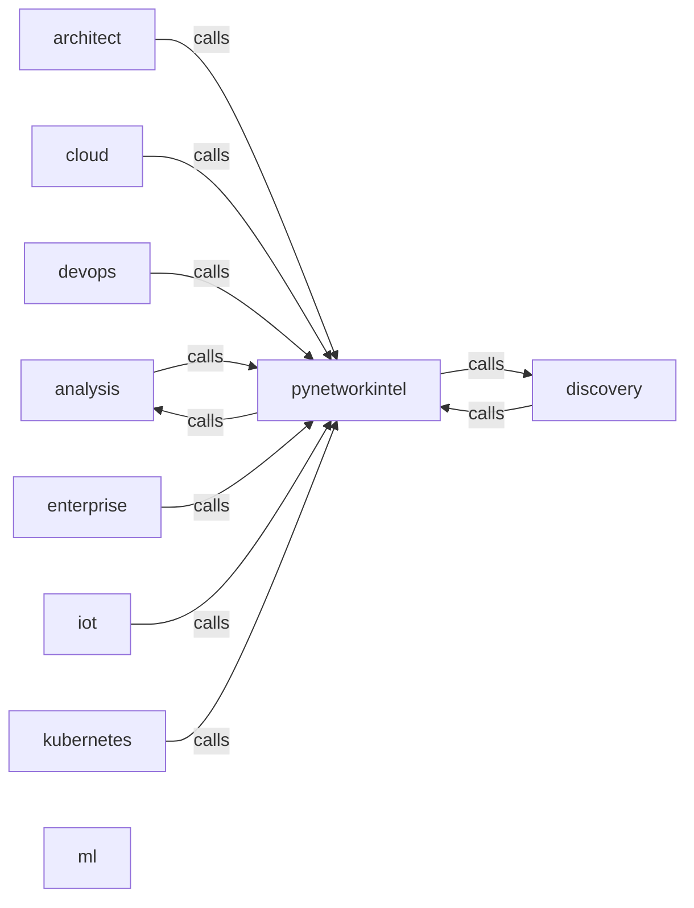

_Generated by CodeAtlas._

## Details

Owns 223 symbols across 16 file(s).

### analysis

Owns 25 symbols across 4 file(s).

**Related Classes/Methods:** _None_

**Source Files:**

- `pynetworkintel/analysis/cve.py`
  - `pynetworkintel.analysis.cve.CVEChecker`
  - `pynetworkintel.analysis.cve.CVEChecker.__init__`
  - `pynetworkintel.analysis.cve.CVEChecker._create_finding`
  - `pynetworkintel.analysis.cve.CVEChecker._cvss_to_severity`
  - `pynetworkintel.analysis.cve.CVEChecker._extract_cvss_score`
  - `pynetworkintel.analysis.cve.CVEChecker._query_nvd`
  - `pynetworkintel.analysis.cve.CVEChecker._respect_rate_limit`
  - `pynetworkintel.analysis.cve.CVEChecker.check_device`
  - `pynetworkintel.analysis.cve.CVEChecker.get_cves_for_service`
- `pynetworkintel/analysis/llm.py`
  - `pynetworkintel.analysis.llm.LLMAnalyzer`
  - `pynetworkintel.analysis.llm.LLMAnalyzer.__init__`
  - `pynetworkintel.analysis.llm.LLMAnalyzer._build_summary_prompt`
  - `pynetworkintel.analysis.llm.LLMAnalyzer._generate_empty_summary`
  - `pynetworkintel.analysis.llm.LLMAnalyzer._generate_fallback_summary`
  - `pynetworkintel.analysis.llm.LLMAnalyzer.explain_finding`
  - `pynetworkintel.analysis.llm.LLMAnalyzer.summarize_findings`
- `pynetworkintel/analysis/rules.py`
  - `pynetworkintel.analysis.rules.Rule`
  - `pynetworkintel.analysis.rules.RuleChecker`
  - `pynetworkintel.analysis.rules.RuleChecker.__init__`
  - `pynetworkintel.analysis.rules.RuleChecker._check_matches`
  - `pynetworkintel.analysis.rules.RuleChecker._extract_evidence`
  - `pynetworkintel.analysis.rules.RuleChecker._load_default_rules`
  - `pynetworkintel.analysis.rules.RuleChecker._rule_matches`
  - `pynetworkintel.analysis.rules.RuleChecker.add_rule`
  - `pynetworkintel.analysis.rules.RuleChecker.check_device`

### architect

Owns 77 symbols across 8 file(s).

**Related Classes/Methods:** _None_

**Source Files:**

- `pynetworkintel/architect/architecture_engine.py`
  - `pynetworkintel.architect.architecture_engine.ArchitectureComponent`
  - `pynetworkintel.architect.architecture_engine.ArchitectureComponent.__post_init__`
  - `pynetworkintel.architect.architecture_engine.ArchitectureEngine`
  - `pynetworkintel.architect.architecture_engine.ArchitectureEngine.__init__`
  - `pynetworkintel.architect.architecture_engine.ArchitectureEngine._calculate_depth`
  - `pynetworkintel.architect.architecture_engine.ArchitectureEngine._generate_mermaid_diagram`
  - `pynetworkintel.architect.architecture_engine.ArchitectureEngine._get_complexity_level`
  - `pynetworkintel.architect.architecture_engine.ArchitectureEngine.add_component`
  - `pynetworkintel.architect.architecture_engine.ArchitectureEngine.add_connection`
  - `pynetworkintel.architect.architecture_engine.ArchitectureEngine.analyze_complexity`
  - `pynetworkintel.architect.architecture_engine.ArchitectureEngine.calculate_high_availability`
  - `pynetworkintel.architect.architecture_engine.ArchitectureEngine.detect_single_points_of_failure`
  - `pynetworkintel.architect.architecture_engine.ArchitectureEngine.export_architecture_diagram`
  - `pynetworkintel.architect.architecture_engine.ArchitectureEngine.suggest_improvements`
- `pynetworkintel/architect/conversational_ai.py`
  - `pynetworkintel.architect.conversational_ai.ConversationalArchitect`
  - `pynetworkintel.architect.conversational_ai.ConversationalArchitect.__init__`
  - `pynetworkintel.architect.conversational_ai.ConversationalArchitect._classify_question`
  - `pynetworkintel.architect.conversational_ai.ConversationalArchitect._extract_topics`
  - `pynetworkintel.architect.conversational_ai.ConversationalArchitect._handle_architecture_review`
  - `pynetworkintel.architect.conversational_ai.ConversationalArchitect._handle_cost_optimization`
  - `pynetworkintel.architect.conversational_ai.ConversationalArchitect._handle_general_inquiry`
  - `pynetworkintel.architect.conversational_ai.ConversationalArchitect._handle_pattern_recommendation`
  - `pynetworkintel.architect.conversational_ai.ConversationalArchitect._handle_roadmap_request`
  - `pynetworkintel.architect.conversational_ai.ConversationalArchitect._handle_service_inquiry`
  - `pynetworkintel.architect.conversational_ai.ConversationalArchitect.chat`
  - `pynetworkintel.architect.conversational_ai.ConversationalArchitect.get_context_awareness`
  - `pynetworkintel.architect.conversational_ai.ConversationalArchitect.get_conversation_summary`
  - `pynetworkintel.architect.conversational_ai.ConversationalArchitect.reset_context`
- `pynetworkintel/architect/knowledge_base.py`
  - `pynetworkintel.architect.knowledge_base.KnowledgeBase`
  - `pynetworkintel.architect.knowledge_base.KnowledgeBase.__init__`
  - `pynetworkintel.architect.knowledge_base.KnowledgeBase._build_knowledge_base`
  - `pynetworkintel.architect.knowledge_base.KnowledgeBase._load_aws_services`
  - `pynetworkintel.architect.knowledge_base.KnowledgeBase._load_azure_services`
  - `pynetworkintel.architect.knowledge_base.KnowledgeBase._load_best_practices`
  - `pynetworkintel.architect.knowledge_base.KnowledgeBase._load_cloud_patterns`
  - `pynetworkintel.architect.knowledge_base.KnowledgeBase._load_compliance_mappings`
  - `pynetworkintel.architect.knowledge_base.KnowledgeBase._load_gcp_services`
  - `pynetworkintel.architect.knowledge_base.KnowledgeBase.get_all_patterns`
  - `pynetworkintel.architect.knowledge_base.KnowledgeBase.get_best_practices`
  - `pynetworkintel.architect.knowledge_base.KnowledgeBase.get_compliance_controls`
  - `pynetworkintel.architect.knowledge_base.KnowledgeBase.get_pattern_info`
  - `pynetworkintel.architect.knowledge_base.KnowledgeBase.get_service_count`
  - `pynetworkintel.architect.knowledge_base.KnowledgeBase.get_service_info`
  - `pynetworkintel.architect.knowledge_base.KnowledgeBase.get_services_by_category`
  - `pynetworkintel.architect.knowledge_base.KnowledgeBase.get_services_by_cloud`
  - `pynetworkintel.architect.knowledge_base.KnowledgeBase.search_services`
- `pynetworkintel/architect/pattern_engine.py`
  - `pynetworkintel.architect.pattern_engine.PatternEngine`
  - `pynetworkintel.architect.pattern_engine.PatternEngine.__init__`
  - `pynetworkintel.architect.pattern_engine.PatternEngine._load_patterns`
  - `pynetworkintel.architect.pattern_engine.PatternEngine.analyze_anti_patterns`
  - `pynetworkintel.architect.pattern_engine.PatternEngine.detect_patterns`
  - `pynetworkintel.architect.pattern_engine.PatternEngine.suggest_patterns`
- `pynetworkintel/architect/recommendation_engine.py`
  - `pynetworkintel.architect.recommendation_engine.RecommendationEngine`
  - `pynetworkintel.architect.recommendation_engine.RecommendationEngine._rank_by_roi`
  - `pynetworkintel.architect.recommendation_engine.RecommendationEngine.generate_recommendations`
  - `pynetworkintel.architect.recommendation_engine.RecommendationEngine.generate_roi_analysis`
- `pynetworkintel/architect/review_engine.py`
  - `pynetworkintel.architect.review_engine.ReviewEngine`
  - `pynetworkintel.architect.review_engine.ReviewEngine._get_cost_recommendations`
  - `pynetworkintel.architect.review_engine.ReviewEngine._get_maturity_level`
  - `pynetworkintel.architect.review_engine.ReviewEngine._get_reliability_recommendations`
  - `pynetworkintel.architect.review_engine.ReviewEngine._get_scalability_recommendations`
  - `pynetworkintel.architect.review_engine.ReviewEngine._get_security_recommendations`
  - `pynetworkintel.architect.review_engine.ReviewEngine._identify_critical_issues`
  - `pynetworkintel.architect.review_engine.ReviewEngine.generate_overall_review`
  - `pynetworkintel.architect.review_engine.ReviewEngine.review_cost`
  - `pynetworkintel.architect.review_engine.ReviewEngine.review_reliability`
  - `pynetworkintel.architect.review_engine.ReviewEngine.review_scalability`
  - `pynetworkintel.architect.review_engine.ReviewEngine.review_security`
- `pynetworkintel/architect/roadmap_engine.py`
  - `pynetworkintel.architect.roadmap_engine.RoadmapEngine`
  - `pynetworkintel.architect.roadmap_engine.RoadmapEngine._create_milestones`
  - `pynetworkintel.architect.roadmap_engine.RoadmapEngine._create_phases`
  - `pynetworkintel.architect.roadmap_engine.RoadmapEngine._define_success_metrics`
  - `pynetworkintel.architect.roadmap_engine.RoadmapEngine._estimate_gap_size`
  - `pynetworkintel.architect.roadmap_engine.RoadmapEngine._get_phase_name`
  - `pynetworkintel.architect.roadmap_engine.RoadmapEngine._identify_critical_path`
  - `pynetworkintel.architect.roadmap_engine.RoadmapEngine._identify_gaps`
  - `pynetworkintel.architect.roadmap_engine.RoadmapEngine.generate_roadmap`

### cloud

Owns 71 symbols across 6 file(s).

**Related Classes/Methods:** _None_

**Source Files:**

- `pynetworkintel/cloud/aws.py`
  - `pynetworkintel.cloud.aws.AWSDiscovery`
  - `pynetworkintel.cloud.aws.AWSDiscovery.__init__`
  - `pynetworkintel.cloud.aws.AWSDiscovery._get_all_regions`
  - `pynetworkintel.cloud.aws.AWSDiscovery._get_tag`
  - `pynetworkintel.cloud.aws.AWSDiscovery._initialize_clients`
  - `pynetworkintel.cloud.aws.AWSDiscovery._tags_to_dict`
  - `pynetworkintel.cloud.aws.AWSDiscovery.discover_all`
  - `pynetworkintel.cloud.aws.AWSDiscovery.discover_ec2_instances`
  - `pynetworkintel.cloud.aws.AWSDiscovery.discover_rds_instances`
  - `pynetworkintel.cloud.aws.AWSDiscovery.discover_s3_buckets`
  - `pynetworkintel.cloud.aws.AWSDiscovery.discover_security_groups`
  - `pynetworkintel.cloud.aws.AWSDiscovery.discover_vpc_networks`
  - `pynetworkintel.cloud.aws.AWSDiscovery.get_resources_summary`
  - `pynetworkintel.cloud.aws.AWSResource`
  - `pynetworkintel.cloud.aws.AWSResource.__post_init__`
  - `pynetworkintel.cloud.aws.AWSResource.to_dict`
- `pynetworkintel/cloud/azure.py`
  - `pynetworkintel.cloud.azure.AzureDiscovery`
  - `pynetworkintel.cloud.azure.AzureDiscovery.__init__`
  - `pynetworkintel.cloud.azure.AzureDiscovery._extract_resource_group`
  - `pynetworkintel.cloud.azure.AzureDiscovery._get_credential`
  - `pynetworkintel.cloud.azure.AzureDiscovery.discover_all`
  - `pynetworkintel.cloud.azure.AzureDiscovery.discover_databases`
  - `pynetworkintel.cloud.azure.AzureDiscovery.discover_network_interfaces`
  - `pynetworkintel.cloud.azure.AzureDiscovery.discover_resource_groups`
  - `pynetworkintel.cloud.azure.AzureDiscovery.discover_storage_accounts`
  - `pynetworkintel.cloud.azure.AzureDiscovery.discover_virtual_machines`
  - `pynetworkintel.cloud.azure.AzureDiscovery.get_resources_summary`
  - `pynetworkintel.cloud.azure.AzureResource`
  - `pynetworkintel.cloud.azure.AzureResource.__post_init__`
  - `pynetworkintel.cloud.azure.AzureResource.to_dict`
- `pynetworkintel/cloud/correlation.py`
  - `pynetworkintel.cloud.correlation.AssetMapping`
  - `pynetworkintel.cloud.correlation.AssetMapping.__post_init__`
  - `pynetworkintel.cloud.correlation.CloudCorrelationEngine`
  - `pynetworkintel.cloud.correlation.CloudCorrelationEngine.__init__`
  - `pynetworkintel.cloud.correlation.CloudCorrelationEngine._get_asset_key`
  - `pynetworkintel.cloud.correlation.CloudCorrelationEngine.add_aws_resource`
  - `pynetworkintel.cloud.correlation.CloudCorrelationEngine.add_azure_resource`
  - `pynetworkintel.cloud.correlation.CloudCorrelationEngine.add_gcp_resource`
  - `pynetworkintel.cloud.correlation.CloudCorrelationEngine.analyze_network_paths`
  - `pynetworkintel.cloud.correlation.CloudCorrelationEngine.detect_resource_clusters`
  - `pynetworkintel.cloud.correlation.CloudCorrelationEngine.find_asset_by_ip`
  - `pynetworkintel.cloud.correlation.CloudCorrelationEngine.find_assets_by_name`
  - `pynetworkintel.cloud.correlation.CloudCorrelationEngine.find_duplicate_assets`
  - `pynetworkintel.cloud.correlation.CloudCorrelationEngine.get_multi_cloud_inventory`
- `pynetworkintel/cloud/credentials.py`
  - `pynetworkintel.cloud.credentials.CloudCredentialManager`
  - `pynetworkintel.cloud.credentials.CloudCredentialManager.__init__`
  - `pynetworkintel.cloud.credentials.CloudCredentialManager.delete_aws_profile`
  - `pynetworkintel.cloud.credentials.CloudCredentialManager.delete_azure_profile`
  - `pynetworkintel.cloud.credentials.CloudCredentialManager.delete_gcp_profile`
  - `pynetworkintel.cloud.credentials.CloudCredentialManager.get_aws_profiles`
  - `pynetworkintel.cloud.credentials.CloudCredentialManager.get_azure_profiles`
  - `pynetworkintel.cloud.credentials.CloudCredentialManager.get_gcp_profiles`
  - `pynetworkintel.cloud.credentials.CloudCredentialManager.load_aws_credentials`
  - `pynetworkintel.cloud.credentials.CloudCredentialManager.load_azure_credentials`
  - `pynetworkintel.cloud.credentials.CloudCredentialManager.load_gcp_credentials`
  - `pynetworkintel.cloud.credentials.CloudCredentialManager.store_aws_credentials`
  - `pynetworkintel.cloud.credentials.CloudCredentialManager.store_azure_credentials`
  - `pynetworkintel.cloud.credentials.CloudCredentialManager.store_gcp_credentials`
- `pynetworkintel/cloud/gcp.py`
  - `pynetworkintel.cloud.gcp.GCPDiscovery`
  - `pynetworkintel.cloud.gcp.GCPDiscovery.__init__`
  - `pynetworkintel.cloud.gcp.GCPDiscovery._get_credentials`
  - `pynetworkintel.cloud.gcp.GCPDiscovery.discover_all`
  - `pynetworkintel.cloud.gcp.GCPDiscovery.discover_cloud_sql_instances`
  - `pynetworkintel.cloud.gcp.GCPDiscovery.discover_cloud_storage_buckets`
  - `pynetworkintel.cloud.gcp.GCPDiscovery.discover_compute_instances`
  - `pynetworkintel.cloud.gcp.GCPDiscovery.discover_firewall_rules`
  - `pynetworkintel.cloud.gcp.GCPDiscovery.discover_networks`
  - `pynetworkintel.cloud.gcp.GCPDiscovery.get_resources_summary`
  - `pynetworkintel.cloud.gcp.GCPResource`
  - `pynetworkintel.cloud.gcp.GCPResource.__post_init__`
  - `pynetworkintel.cloud.gcp.GCPResource.to_dict`

### devops

Owns 41 symbols across 5 file(s).

**Related Classes/Methods:** _None_

**Source Files:**

- `pynetworkintel/devops/cicd_scanner.py`
  - `pynetworkintel.devops.cicd_scanner.CICDPipelineScanner`
  - `pynetworkintel.devops.cicd_scanner.CICDPipelineScanner.__init__`
  - `pynetworkintel.devops.cicd_scanner.CICDPipelineScanner._find_line_number`
  - `pynetworkintel.devops.cicd_scanner.CICDPipelineScanner._get_cicd_recommendations`
  - `pynetworkintel.devops.cicd_scanner.CICDPipelineScanner._is_official_image`
  - `pynetworkintel.devops.cicd_scanner.CICDPipelineScanner._is_trusted_package`
  - `pynetworkintel.devops.cicd_scanner.CICDPipelineScanner.detect_supply_chain_risks`
  - `pynetworkintel.devops.cicd_scanner.CICDPipelineScanner.generate_hardening_recommendations`
  - `pynetworkintel.devops.cicd_scanner.CICDPipelineScanner.scan_github_actions`
  - `pynetworkintel.devops.cicd_scanner.CICDPipelineScanner.scan_gitlab_ci`
  - `pynetworkintel.devops.cicd_scanner.CICDPipelineScanner.scan_jenkins_pipeline`
- `pynetworkintel/devops/compliance.py`
  - `pynetworkintel.devops.compliance.ComplianceMapper`
  - `pynetworkintel.devops.compliance.ComplianceMapper.__init__`
  - `pynetworkintel.devops.compliance.ComplianceMapper._get_framework_recommendations`
  - `pynetworkintel.devops.compliance.ComplianceMapper._load_compliance_mappings`
  - `pynetworkintel.devops.compliance.ComplianceMapper.generate_compliance_report`
  - `pynetworkintel.devops.compliance.ComplianceMapper.get_remediation_timeline`
  - `pynetworkintel.devops.compliance.ComplianceMapper.map_to_cis_controls`
  - `pynetworkintel.devops.compliance.ComplianceMapper.map_to_hipaa`
  - `pynetworkintel.devops.compliance.ComplianceMapper.map_to_iso27001`
  - `pynetworkintel.devops.compliance.ComplianceMapper.map_to_pci_dss`
- `pynetworkintel/devops/iac_validator.py`
  - `pynetworkintel.devops.iac_validator.IaCValidator`
  - `pynetworkintel.devops.iac_validator.IaCValidator.__init__`
  - `pynetworkintel.devops.iac_validator.IaCValidator._has_network_policy`
  - `pynetworkintel.devops.iac_validator.IaCValidator.generate_remediation_plan`
  - `pynetworkintel.devops.iac_validator.IaCValidator.validate_cloudformation`
  - `pynetworkintel.devops.iac_validator.IaCValidator.validate_docker_compose`
  - `pynetworkintel.devops.iac_validator.IaCValidator.validate_kubernetes_manifests`
  - `pynetworkintel.devops.iac_validator.IaCValidator.validate_terraform`
- `pynetworkintel/devops/siem_integrator.py`
  - `pynetworkintel.devops.siem_integrator.SIEMIntegrator`
  - `pynetworkintel.devops.siem_integrator.SIEMIntegrator.__init__`
  - `pynetworkintel.devops.siem_integrator.SIEMIntegrator._format_for_siem`
  - `pynetworkintel.devops.siem_integrator.SIEMIntegrator._send_to_datadog`
  - `pynetworkintel.devops.siem_integrator.SIEMIntegrator._send_to_elk`
  - `pynetworkintel.devops.siem_integrator.SIEMIntegrator._send_to_splunk`
  - `pynetworkintel.devops.siem_integrator.SIEMIntegrator._send_to_splunk_hec`
  - `pynetworkintel.devops.siem_integrator.SIEMIntegrator.get_integration_status`
  - `pynetworkintel.devops.siem_integrator.SIEMIntegrator.send_anomaly_alert`
  - `pynetworkintel.devops.siem_integrator.SIEMIntegrator.send_change_alert`
  - `pynetworkintel.devops.siem_integrator.SIEMIntegrator.send_scan_results`
  - `pynetworkintel.devops.siem_integrator.SIEMIntegrator.send_vulnerability_alert`

### discovery

Owns 23 symbols across 3 file(s).

**Related Classes/Methods:** _None_

**Source Files:**

- `pynetworkintel/discovery/scanner.py`
  - `pynetworkintel.discovery.scanner.ARPScanner`
  - `pynetworkintel.discovery.scanner.ARPScanner._get_default_interface`
  - `pynetworkintel.discovery.scanner.ARPScanner._is_valid_ip`
  - `pynetworkintel.discovery.scanner.ARPScanner.scan_local`
  - `pynetworkintel.discovery.scanner.DeviceScanner`
  - `pynetworkintel.discovery.scanner.DeviceScanner.__init__`
  - `pynetworkintel.discovery.scanner.DeviceScanner.discover`
  - `pynetworkintel.discovery.scanner.DeviceScanner.discover_local`
  - `pynetworkintel.discovery.scanner.NmapScanner`
  - `pynetworkintel.discovery.scanner.NmapScanner.__init__`
  - `pynetworkintel.discovery.scanner.NmapScanner._check_nmap_available`
  - `pynetworkintel.discovery.scanner.NmapScanner._parse_host`
  - `pynetworkintel.discovery.scanner.NmapScanner._parse_nmap_xml`
  - `pynetworkintel.discovery.scanner.NmapScanner._parse_service`
  - `pynetworkintel.discovery.scanner.NmapScanner.scan`
  - `pynetworkintel.discovery.scanner.validate_target`
- `pynetworkintel/discovery/ssh_config.py`
  - `pynetworkintel.discovery.ssh_config.SSHConfigGrabber`
  - `pynetworkintel.discovery.ssh_config.SSHConfigGrabber.__init__`
  - `pynetworkintel.discovery.ssh_config.SSHConfigGrabber._connect`
  - `pynetworkintel.discovery.ssh_config.SSHConfigGrabber._grab_linux_configs`
  - `pynetworkintel.discovery.ssh_config.SSHConfigGrabber._read_file`
  - `pynetworkintel.discovery.ssh_config.SSHConfigGrabber._run_command`
  - `pynetworkintel.discovery.ssh_config.SSHConfigGrabber.grab_configs`

### enterprise

Owns 99 symbols across 7 file(s).

**Related Classes/Methods:** _None_

**Source Files:**

- `pynetworkintel/enterprise/api.py`
  - `pynetworkintel.enterprise.api.Endpoint`
  - `pynetworkintel.enterprise.api.RESTAPIServer`
  - `pynetworkintel.enterprise.api.RESTAPIServer.__init__`
  - `pynetworkintel.enterprise.api.RESTAPIServer._handle_analyze_device`
  - `pynetworkintel.enterprise.api.RESTAPIServer._handle_get_alerts`
  - `pynetworkintel.enterprise.api.RESTAPIServer._handle_get_changes`
  - `pynetworkintel.enterprise.api.RESTAPIServer._handle_get_devices`
  - `pynetworkintel.enterprise.api.RESTAPIServer._handle_get_vulnerabilities`
  - `pynetworkintel.enterprise.api.RESTAPIServer._handle_scan`
  - `pynetworkintel.enterprise.api.RESTAPIServer.check_rate_limit`
  - `pynetworkintel.enterprise.api.RESTAPIServer.get_openapi_spec`
  - `pynetworkintel.enterprise.api.RESTAPIServer.health_check`
  - `pynetworkintel.enterprise.api.RESTAPIServer.register_analysis_endpoints`
  - `pynetworkintel.enterprise.api.RESTAPIServer.register_discovery_endpoints`
  - `pynetworkintel.enterprise.api.RESTAPIServer.register_endpoint`
  - `pynetworkintel.enterprise.api.RESTAPIServer.register_monitoring_endpoints`
  - `pynetworkintel.enterprise.api.RESTAPIServer.start`
  - `pynetworkintel.enterprise.api.RESTAPIServer.stop`
- `pynetworkintel/enterprise/authentication.py`
  - `pynetworkintel.enterprise.authentication.AuthenticationManager`
  - `pynetworkintel.enterprise.authentication.AuthenticationManager.__init__`
  - `pynetworkintel.enterprise.authentication.AuthenticationManager._generate_session_token`
  - `pynetworkintel.enterprise.authentication.AuthenticationManager._hash_password`
  - `pynetworkintel.enterprise.authentication.AuthenticationManager._verify_password`
  - `pynetworkintel.enterprise.authentication.AuthenticationManager.authenticate`
  - `pynetworkintel.enterprise.authentication.AuthenticationManager.authorize`
  - `pynetworkintel.enterprise.authentication.AuthenticationManager.change_password`
  - `pynetworkintel.enterprise.authentication.AuthenticationManager.configure_ldap`
  - `pynetworkintel.enterprise.authentication.AuthenticationManager.configure_oauth`
  - `pynetworkintel.enterprise.authentication.AuthenticationManager.configure_saml`
  - `pynetworkintel.enterprise.authentication.AuthenticationManager.create_user`
  - `pynetworkintel.enterprise.authentication.AuthenticationManager.enable_mfa`
  - `pynetworkintel.enterprise.authentication.AuthenticationManager.get_user_info`
  - `pynetworkintel.enterprise.authentication.AuthenticationManager.reset_password`
  - `pynetworkintel.enterprise.authentication.AuthenticationManager.revoke_session`
  - `pynetworkintel.enterprise.authentication.AuthenticationManager.validate_session`
  - `pynetworkintel.enterprise.authentication.AuthenticationManager.verify_mfa`
  - `pynetworkintel.enterprise.authentication.User`
- `pynetworkintel/enterprise/compliance.py`
  - `pynetworkintel.enterprise.compliance.ComplianceAuditor`
  - `pynetworkintel.enterprise.compliance.ComplianceAuditor.__init__`
  - `pynetworkintel.enterprise.compliance.ComplianceAuditor._generate_html_report`
  - `pynetworkintel.enterprise.compliance.ComplianceAuditor.audit_hipaa`
  - `pynetworkintel.enterprise.compliance.ComplianceAuditor.audit_iso27001`
  - `pynetworkintel.enterprise.compliance.ComplianceAuditor.audit_pci_dss`
  - `pynetworkintel.enterprise.compliance.ComplianceAuditor.audit_soc2_type2`
  - `pynetworkintel.enterprise.compliance.ComplianceAuditor.export_compliance_report`
  - `pynetworkintel.enterprise.compliance.ComplianceAuditor.generate_audit_report`
  - `pynetworkintel.enterprise.compliance.ComplianceAuditor.get_compliance_dashboard`
  - `pynetworkintel.enterprise.compliance.ComplianceAuditor.record_audit_entry`
  - `pynetworkintel.enterprise.compliance.ComplianceAuditor.store_evidence`
- `pynetworkintel/enterprise/ha.py`
  - `pynetworkintel.enterprise.ha.HAArchitecture`
  - `pynetworkintel.enterprise.ha.HAArchitecture.__init__`
  - `pynetworkintel.enterprise.ha.HAArchitecture._elect_leader`
  - `pynetworkintel.enterprise.ha.HAArchitecture.check_node_health`
  - `pynetworkintel.enterprise.ha.HAArchitecture.deregister_node`
  - `pynetworkintel.enterprise.ha.HAArchitecture.enable_database_replication`
  - `pynetworkintel.enterprise.ha.HAArchitecture.enable_load_balancing`
  - `pynetworkintel.enterprise.ha.HAArchitecture.enable_session_replication`
  - `pynetworkintel.enterprise.ha.HAArchitecture.failover`
  - `pynetworkintel.enterprise.ha.HAArchitecture.get_cluster_status`
  - `pynetworkintel.enterprise.ha.HAArchitecture.get_load_distribution`
  - `pynetworkintel.enterprise.ha.HAArchitecture.get_node_info`
  - `pynetworkintel.enterprise.ha.HAArchitecture.graceful_shutdown`
  - `pynetworkintel.enterprise.ha.HAArchitecture.heartbeat`
  - `pynetworkintel.enterprise.ha.HAArchitecture.register_node`
  - `pynetworkintel.enterprise.ha.NodeStatus`
- `pynetworkintel/enterprise/multitenancy.py`
  - `pynetworkintel.enterprise.multitenancy.TenantConfig`
  - `pynetworkintel.enterprise.multitenancy.TenantManager`
  - `pynetworkintel.enterprise.multitenancy.TenantManager.__init__`
  - `pynetworkintel.enterprise.multitenancy.TenantManager._generate_api_key`
  - `pynetworkintel.enterprise.multitenancy.TenantManager._generate_encryption_key`
  - `pynetworkintel.enterprise.multitenancy.TenantManager._generate_tenant_id`
  - `pynetworkintel.enterprise.multitenancy.TenantManager.check_quota`
  - `pynetworkintel.enterprise.multitenancy.TenantManager.create_tenant`
  - `pynetworkintel.enterprise.multitenancy.TenantManager.delete_tenant`
  - `pynetworkintel.enterprise.multitenancy.TenantManager.disable_feature`
  - `pynetworkintel.enterprise.multitenancy.TenantManager.enable_feature`
  - `pynetworkintel.enterprise.multitenancy.TenantManager.generate_api_key`
  - `pynetworkintel.enterprise.multitenancy.TenantManager.get_row_level_security_filter`
  - `pynetworkintel.enterprise.multitenancy.TenantManager.get_tenant_info`
  - `pynetworkintel.enterprise.multitenancy.TenantManager.get_tenant_quota`
  - `pynetworkintel.enterprise.multitenancy.TenantManager.isolate_data`
  - `pynetworkintel.enterprise.multitenancy.TenantManager.retrieve_tenant_data`
  - `pynetworkintel.enterprise.multitenancy.TenantManager.update_encryption_key`
  - `pynetworkintel.enterprise.multitenancy.TenantManager.validate_api_key`
- `pynetworkintel/enterprise/observability.py`
  - `pynetworkintel.enterprise.observability.ObservabilityManager`
  - `pynetworkintel.enterprise.observability.ObservabilityManager.__init__`
  - `pynetworkintel.enterprise.observability.ObservabilityManager.enable_opentelemetry`
  - `pynetworkintel.enterprise.observability.ObservabilityManager.enable_prometheus_export`
  - `pynetworkintel.enterprise.observability.ObservabilityManager.enable_structured_logging`
  - `pynetworkintel.enterprise.observability.ObservabilityManager.end_trace`
  - `pynetworkintel.enterprise.observability.ObservabilityManager.export_logs_json`
  - `pynetworkintel.enterprise.observability.ObservabilityManager.export_prometheus_metrics`
  - `pynetworkintel.enterprise.observability.ObservabilityManager.export_traces_jaeger`
  - `pynetworkintel.enterprise.observability.ObservabilityManager.get_dashboard_data`
  - `pynetworkintel.enterprise.observability.ObservabilityManager.get_metrics_summary`
  - `pynetworkintel.enterprise.observability.ObservabilityManager.get_trace_statistics`
  - `pynetworkintel.enterprise.observability.ObservabilityManager.record_log`
  - `pynetworkintel.enterprise.observability.ObservabilityManager.record_metric`
  - `pynetworkintel.enterprise.observability.ObservabilityManager.start_trace`

### iot

Owns 41 symbols across 4 file(s).

**Related Classes/Methods:** _None_

**Source Files:**

- `pynetworkintel/iot/discovery.py`
  - `pynetworkintel.iot.discovery.IoTDevice`
  - `pynetworkintel.iot.discovery.IoTDevice.__post_init__`
  - `pynetworkintel.iot.discovery.IoTDevice.to_dict`
  - `pynetworkintel.iot.discovery.IoTDeviceDiscovery`
  - `pynetworkintel.iot.discovery.IoTDeviceDiscovery.__init__`
  - `pynetworkintel.iot.discovery.IoTDeviceDiscovery._get_mqtt_broker_info`
  - `pynetworkintel.iot.discovery.IoTDeviceDiscovery._get_mqtt_broker_info.on_connect`
  - `pynetworkintel.iot.discovery.IoTDeviceDiscovery._get_mqtt_broker_info.on_message`
  - `pynetworkintel.iot.discovery.IoTDeviceDiscovery._is_likely_gateway`
  - `pynetworkintel.iot.discovery.IoTDeviceDiscovery._parse_network_range`
  - `pynetworkintel.iot.discovery.IoTDeviceDiscovery.discover_gateway_devices`
  - `pynetworkintel.iot.discovery.IoTDeviceDiscovery.discover_industrial_controllers`
  - `pynetworkintel.iot.discovery.IoTDeviceDiscovery.discover_iot_devices`
  - `pynetworkintel.iot.discovery.IoTDeviceDiscovery.discover_mqtt_brokers`
  - `pynetworkintel.iot.discovery.IoTDeviceDiscovery.get_device_summary`
  - `pynetworkintel.iot.discovery.IoTDeviceDiscovery.track_firmware_versions`
- `pynetworkintel/iot/protocols.py`
  - `pynetworkintel.iot.protocols.ProtocolAnalyzer`
  - `pynetworkintel.iot.protocols.ProtocolAnalyzer.__init__`
  - `pynetworkintel.iot.protocols.ProtocolAnalyzer._calculate_protocol_security`
  - `pynetworkintel.iot.protocols.ProtocolAnalyzer._get_encrypted_variant`
  - `pynetworkintel.iot.protocols.ProtocolAnalyzer._get_protocol_recommendations`
  - `pynetworkintel.iot.protocols.ProtocolAnalyzer.analyze_protocol_security`
  - `pynetworkintel.iot.protocols.ProtocolAnalyzer.analyze_protocol_usage`
  - `pynetworkintel.iot.protocols.ProtocolAnalyzer.detect_unencrypted_protocols`
  - `pynetworkintel.iot.protocols.ProtocolAnalyzer.detect_weak_authentication`
  - `pynetworkintel.iot.protocols.ProtocolAnalyzer.get_default_credentials`
- `pynetworkintel/iot/vulnerabilities.py`
  - `pynetworkintel.iot.vulnerabilities.IoTVulnerabilityAnalyzer`
  - `pynetworkintel.iot.vulnerabilities.IoTVulnerabilityAnalyzer.__init__`
  - `pynetworkintel.iot.vulnerabilities.IoTVulnerabilityAnalyzer._calculate_device_risk`
  - `pynetworkintel.iot.vulnerabilities.IoTVulnerabilityAnalyzer._check_http_vulnerabilities`
  - `pynetworkintel.iot.vulnerabilities.IoTVulnerabilityAnalyzer._check_mqtt_vulnerabilities`
  - `pynetworkintel.iot.vulnerabilities.IoTVulnerabilityAnalyzer._get_default_creds_for_device`
  - `pynetworkintel.iot.vulnerabilities.IoTVulnerabilityAnalyzer._get_model_vulnerabilities`
  - `pynetworkintel.iot.vulnerabilities.IoTVulnerabilityAnalyzer._get_recommendations`
  - `pynetworkintel.iot.vulnerabilities.IoTVulnerabilityAnalyzer._get_remediation_priority`
  - `pynetworkintel.iot.vulnerabilities.IoTVulnerabilityAnalyzer._get_risk_level`
  - `pynetworkintel.iot.vulnerabilities.IoTVulnerabilityAnalyzer.analyze_device_fleet`
  - `pynetworkintel.iot.vulnerabilities.IoTVulnerabilityAnalyzer.check_firmware_vulnerabilities`
  - `pynetworkintel.iot.vulnerabilities.IoTVulnerabilityAnalyzer.check_protocol_vulnerabilities`
  - `pynetworkintel.iot.vulnerabilities.IoTVulnerabilityAnalyzer.detect_default_credentials`
  - `pynetworkintel.iot.vulnerabilities.IoTVulnerabilityAnalyzer.scan_device_security`

### kubernetes

Owns 52 symbols across 5 file(s).

**Related Classes/Methods:** _None_

**Source Files:**

- `pynetworkintel/kubernetes/discovery.py`
  - `pynetworkintel.kubernetes.discovery.K8sResource`
  - `pynetworkintel.kubernetes.discovery.K8sResource.__post_init__`
  - `pynetworkintel.kubernetes.discovery.K8sResource.to_dict`
  - `pynetworkintel.kubernetes.discovery.KubernetesDiscovery`
  - `pynetworkintel.kubernetes.discovery.KubernetesDiscovery.__init__`
  - `pynetworkintel.kubernetes.discovery.KubernetesDiscovery._get_node_status`
  - `pynetworkintel.kubernetes.discovery.KubernetesDiscovery._initialize`
  - `pynetworkintel.kubernetes.discovery.KubernetesDiscovery.discover_all`
  - `pynetworkintel.kubernetes.discovery.KubernetesDiscovery.discover_deployments`
  - `pynetworkintel.kubernetes.discovery.KubernetesDiscovery.discover_namespaces`
  - `pynetworkintel.kubernetes.discovery.KubernetesDiscovery.discover_nodes`
  - `pynetworkintel.kubernetes.discovery.KubernetesDiscovery.discover_pods`
  - `pynetworkintel.kubernetes.discovery.KubernetesDiscovery.discover_secrets`
  - `pynetworkintel.kubernetes.discovery.KubernetesDiscovery.discover_services`
  - `pynetworkintel.kubernetes.discovery.KubernetesDiscovery.get_cluster_info`
  - `pynetworkintel.kubernetes.discovery.KubernetesDiscovery.get_resources_summary`
- `pynetworkintel/kubernetes/network_policy.py`
  - `pynetworkintel.kubernetes.network_policy.NetworkPolicyAnalyzer`
  - `pynetworkintel.kubernetes.network_policy.NetworkPolicyAnalyzer.__init__`
  - `pynetworkintel.kubernetes.network_policy.NetworkPolicyAnalyzer._extract_egress_rules`
  - `pynetworkintel.kubernetes.network_policy.NetworkPolicyAnalyzer._extract_ingress_rules`
  - `pynetworkintel.kubernetes.network_policy.NetworkPolicyAnalyzer._initialize_client`
  - `pynetworkintel.kubernetes.network_policy.NetworkPolicyAnalyzer.analyze_network_policies`
  - `pynetworkintel.kubernetes.network_policy.NetworkPolicyAnalyzer.find_namespaces_without_policies`
  - `pynetworkintel.kubernetes.network_policy.NetworkPolicyAnalyzer.find_overly_permissive_policies`
  - `pynetworkintel.kubernetes.network_policy.NetworkPolicyAnalyzer.get_network_policy_coverage`
- `pynetworkintel/kubernetes/rbac.py`
  - `pynetworkintel.kubernetes.rbac.RBACAnalyzer`
  - `pynetworkintel.kubernetes.rbac.RBACAnalyzer.__init__`
  - `pynetworkintel.kubernetes.rbac.RBACAnalyzer._assess_binding_risk`
  - `pynetworkintel.kubernetes.rbac.RBACAnalyzer._calculate_role_risk`
  - `pynetworkintel.kubernetes.rbac.RBACAnalyzer._extract_permissions`
  - `pynetworkintel.kubernetes.rbac.RBACAnalyzer._get_risk_level`
  - `pynetworkintel.kubernetes.rbac.RBACAnalyzer._get_role_recommendations`
  - `pynetworkintel.kubernetes.rbac.RBACAnalyzer._initialize_client`
  - `pynetworkintel.kubernetes.rbac.RBACAnalyzer.analyze_cluster_role_bindings`
  - `pynetworkintel.kubernetes.rbac.RBACAnalyzer.analyze_cluster_roles`
  - `pynetworkintel.kubernetes.rbac.RBACAnalyzer.analyze_role_bindings`
  - `pynetworkintel.kubernetes.rbac.RBACAnalyzer.analyze_roles`
  - `pynetworkintel.kubernetes.rbac.RBACAnalyzer.find_overprivileged_service_accounts`
  - `pynetworkintel.kubernetes.rbac.RBACAnalyzer.get_rbac_summary`
- `pynetworkintel/kubernetes/security.py`
  - `pynetworkintel.kubernetes.security.ContainerSecurityAnalyzer`
  - `pynetworkintel.kubernetes.security.ContainerSecurityAnalyzer.__init__`
  - `pynetworkintel.kubernetes.security.ContainerSecurityAnalyzer._assess_image_risk`
  - `pynetworkintel.kubernetes.security.ContainerSecurityAnalyzer._calculate_pod_risk`
  - `pynetworkintel.kubernetes.security.ContainerSecurityAnalyzer._check_image`
  - `pynetworkintel.kubernetes.security.ContainerSecurityAnalyzer._check_pod_security`
  - `pynetworkintel.kubernetes.security.ContainerSecurityAnalyzer._initialize_client`
  - `pynetworkintel.kubernetes.security.ContainerSecurityAnalyzer.analyze_pod_security`
  - `pynetworkintel.kubernetes.security.ContainerSecurityAnalyzer.check_resource_limits`
  - `pynetworkintel.kubernetes.security.ContainerSecurityAnalyzer.find_containers_running_as_root`
  - `pynetworkintel.kubernetes.security.ContainerSecurityAnalyzer.find_privileged_containers`
  - `pynetworkintel.kubernetes.security.ContainerSecurityAnalyzer.get_security_summary`
  - `pynetworkintel.kubernetes.security.ContainerSecurityAnalyzer.scan_container_images`

### ml

Owns 46 symbols across 4 file(s).

**Related Classes/Methods:** _None_

**Source Files:**

- `pynetworkintel/ml/anomaly.py`
  - `pynetworkintel.ml.anomaly.AnomalyDetector`
  - `pynetworkintel.ml.anomaly.AnomalyDetector.__init__`
  - `pynetworkintel.ml.anomaly.AnomalyDetector._get_baseline_ports`
  - `pynetworkintel.ml.anomaly.AnomalyDetector._is_suspicious_destination`
  - `pynetworkintel.ml.anomaly.AnomalyDetector.analyze_traffic_pattern`
  - `pynetworkintel.ml.anomaly.AnomalyDetector.detect_bandwidth_anomaly`
  - `pynetworkintel.ml.anomaly.AnomalyDetector.detect_connection_anomaly`
  - `pynetworkintel.ml.anomaly.AnomalyDetector.detect_port_scan_activity`
  - `pynetworkintel.ml.anomaly.AnomalyDetector.detect_protocol_anomaly`
  - `pynetworkintel.ml.anomaly.AnomalyDetector.detect_timing_anomaly`
  - `pynetworkintel.ml.anomaly.AnomalyDetector.get_anomalies`
  - `pynetworkintel.ml.anomaly.AnomalyDetector.record_traffic`
- `pynetworkintel/ml/behavioral.py`
  - `pynetworkintel.ml.behavioral.BehavioralBaseline`
  - `pynetworkintel.ml.behavioral.BehavioralBaseline.__init__`
  - `pynetworkintel.ml.behavioral.BehavioralBaseline._calculate_similarity`
  - `pynetworkintel.ml.behavioral.BehavioralBaseline._get_top_ports`
  - `pynetworkintel.ml.behavioral.BehavioralBaseline._get_top_services`
  - `pynetworkintel.ml.behavioral.BehavioralBaseline._update_baseline_metrics`
  - `pynetworkintel.ml.behavioral.BehavioralBaseline.compare_baselines`
  - `pynetworkintel.ml.behavioral.BehavioralBaseline.detect_anomalies`
  - `pynetworkintel.ml.behavioral.BehavioralBaseline.get_baseline_status`
  - `pynetworkintel.ml.behavioral.BehavioralBaseline.get_device_fingerprint`
  - `pynetworkintel.ml.behavioral.BehavioralBaseline.get_fleet_statistics`
  - `pynetworkintel.ml.behavioral.BehavioralBaseline.record_device_activity`
  - `pynetworkintel.ml.behavioral.BehavioralBaseline.record_port_activity`
  - `pynetworkintel.ml.behavioral.BehavioralBaseline.record_service_activity`
  - `pynetworkintel.ml.behavioral.DeviceBaseline`
- `pynetworkintel/ml/predictive.py`
  - `pynetworkintel.ml.predictive.PredictiveAnalyzer`
  - `pynetworkintel.ml.predictive.PredictiveAnalyzer.__init__`
  - `pynetworkintel.ml.predictive.PredictiveAnalyzer._analyze_severity_trend`
  - `pynetworkintel.ml.predictive.PredictiveAnalyzer._calculate_discovery_rate`
  - `pynetworkintel.ml.predictive.PredictiveAnalyzer._estimate_days_to_critical`
  - `pynetworkintel.ml.predictive.PredictiveAnalyzer._get_mitigation_priority`
  - `pynetworkintel.ml.predictive.PredictiveAnalyzer._get_patch_recommendation`
  - `pynetworkintel.ml.predictive.PredictiveAnalyzer._get_risk_factors`
  - `pynetworkintel.ml.predictive.PredictiveAnalyzer._get_risk_from_count`
  - `pynetworkintel.ml.predictive.PredictiveAnalyzer._get_risk_level`
  - `pynetworkintel.ml.predictive.PredictiveAnalyzer._get_severity_recommendation`
  - `pynetworkintel.ml.predictive.PredictiveAnalyzer._get_urgency_level`
  - `pynetworkintel.ml.predictive.PredictiveAnalyzer._is_recent`
  - `pynetworkintel.ml.predictive.PredictiveAnalyzer.forecast_attack_surface_growth`
  - `pynetworkintel.ml.predictive.PredictiveAnalyzer.predict_device_risk_score`
  - `pynetworkintel.ml.predictive.PredictiveAnalyzer.predict_future_vulnerabilities`
  - `pynetworkintel.ml.predictive.PredictiveAnalyzer.predict_patch_urgency`
  - `pynetworkintel.ml.predictive.PredictiveAnalyzer.predict_severity_trends`
  - `pynetworkintel.ml.predictive.PredictiveAnalyzer.record_vulnerability`
